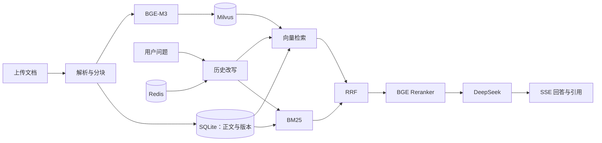

# 知源 · 文档知识库与 RAG 问答

知源将 PDF、Word 和 Markdown 文档转换为可检索的知识库，提供带原文引用的问答。系统围绕文档版本一致性、混合检索和多轮对话构建，支持文档增量更新、删除同步与证据追溯。

## 核心能力

- **文档管理**：解析与清洗 PDF、DOCX、Markdown，结合标题层级和重叠窗口分块；后台入库任务支持状态查询和失败重试。
- **版本与隔离**：按知识库 ID 限定查询范围；新版本入库成功后切换有效版本，复用未变化分块的向量，清理旧版本索引。
- **混合检索**：BGE-M3 向量检索与中文 BM25 关键词检索共同提供候选，经过 RRF 融合及 BGE Reranker 重排序后筛选证据。
- **证据问答**：通过 LangChain 调用 DeepSeek，展示文档名称、版本和原文位置；无有效证据时拒答。
- **多轮与流式输出**：Redis 保存近期对话，历史改写补全追问，SSE 实时传输回答与引用。
- **效果评测**：对比纯向量、混合检索及重排序策略，统计 Recall@K、响应时延与人工标注的正确率、引用支持率。

## 系统架构



SQLite 中的有效版本决定可检索范围，Milvus 保存向量索引，Redis 保存会话上下文。默认部署使用 Milvus standalone 的内嵌 etcd 和本地持久存储。

## 技术栈

| 层次 | 技术 |
| --- | --- |
| API 与数据管理 | FastAPI、SQLAlchemy、SQLite |
| 文档解析 | pypdf、python-docx、markdown-it-py |
| 检索与排序 | BGE-M3、Milvus、jieba、BM25、RRF、BGE Reranker |
| 生成与会话 | LangChain、DeepSeek、Redis、SSE |
| 页面与部署 | HTML / CSS / JavaScript、Docker Compose |

## 快速启动

环境要求：Python 3.11+、Docker Compose。Windows 使用以下 PowerShell 命令：

```powershell
# 创建虚拟环境并安装锁定依赖；首次运行会复制 .env.example
powershell -ExecutionPolicy Bypass -File scripts/setup.ps1

# 在 .env 中填写 DEEPSEEK_API_KEY，并根据环境调整模型和存储配置
powershell -ExecutionPolicy Bypass -File scripts/start-infra.ps1
powershell -ExecutionPolicy Bypass -File scripts/start.ps1
```

打开 http://127.0.0.1:8000 ，创建知识库，上传 `samples/员工手册.md`，等待入库完成后提问。接口文档位于 `/docs`。首次真实入库会下载并加载 BGE 模型。

Docker 不在 PATH 时，可向 `start-infra.ps1` 传入 `-DockerPath`。Linux/macOS 的虚拟环境、启动命令及详细配置见[部署说明](docs/deployment.md)。无需外部服务的演示入口为 `scripts/start.ps1 -Demo`，用于检查交互流程。

## 问答接口

创建知识库并完成文档入库后，向对应知识库发送请求：

```http
POST /api/knowledge-bases/{kb_id}/chat
Content-Type: application/json

{"question": "正式员工每年有几天年假？", "session_id": "aaaaaaaaaaaaaaaaaaaaaaaaaaaaaaaa"}
```

响应为 SSE，依次传输进度、原文证据、回答片段和完成事件。同一 session_id 用于后续追问；省略时由后端创建新会话。

## 目录结构

```text
app/                    API、解析、入库、检索、生成与会话模块
web/                    文档管理与流式问答页面
scripts/
  setup.ps1             环境初始化
  start.ps1             后端启动
  start-infra.ps1        数据库服务启动
  check.ps1             测试与语法检查
  docs/                 学习手册生成与 Markdown 导出
  evaluation/           检索与回答评测
  verification/         外部服务、模型与浏览器验收
deploy/                内嵌 etcd 配置及可选 Windows 安装工具
docs/                  架构、部署、评测、验收和逐行学习手册
tests/                 自动业务测试
eval/                  固定评测数据集
samples/               示例文档
```

## 验证与评测

```powershell
powershell -ExecutionPolicy Bypass -File scripts/check.ps1
.venv/Scripts/python.exe scripts/verification/probe_services.py --infra
.venv/Scripts/python.exe scripts/evaluation/evaluate.py --kb YOUR_KB_ID --generate
```

已通过 20 项业务测试，并完成真实 BGE、Milvus、Redis、DeepSeek 联调及浏览器问答验收。在 15 道虚构员工手册题目上，三种策略的 Recall@6 均为 1.0；该样本规模不足以证明策略之间的泛化优势。回答正确率和引用准确率在人工标注前保持未知。详见[验收记录](docs/verification.md)与[评测说明](docs/evaluation.md)。

## 使用范围

当前为单进程、本机单用户部署；知识库逻辑隔离不包含用户身份认证。PDF 需具有文本层，旧版 Word `.doc` 需转换为 `.docx`。BM25 在有效分块上计算，适合小型知识库；大规模部署需增加全文检索服务、权限控制和任务调度能力。引用编号校验不等于语义正确性验证。

## 项目文档

- [架构与模块职责](docs/architecture.md)
- [部署与维护](docs/deployment.md)
- [评测方法](docs/evaluation.md)
- [完整逐行学习手册](docs/项目学习手册.md)
- [文档索引](docs/README.md)

密钥、上传资料、数据库和模型缓存保留在本地，不进入版本控制。
